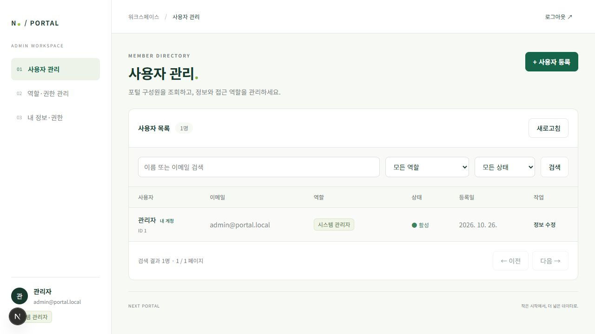
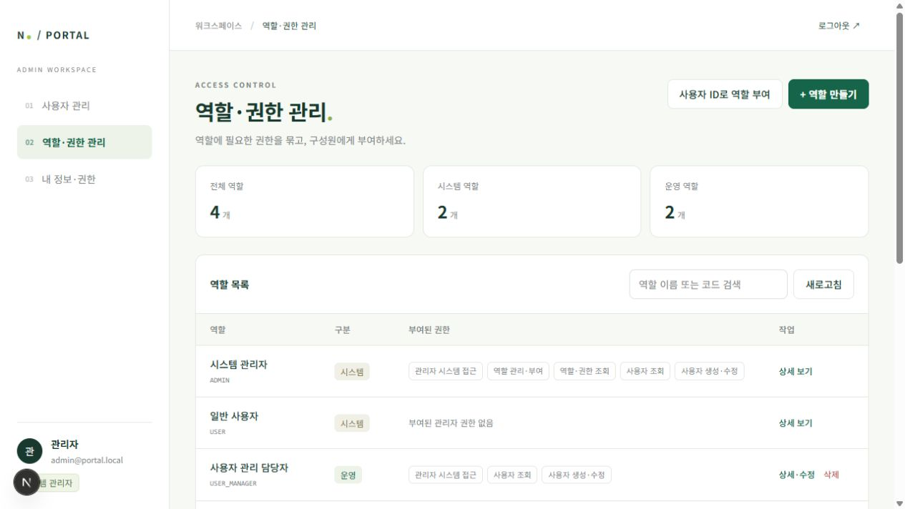

# Next Portal Frontend

Next.js App Router, React, TypeScript, Tailwind CSS 기반의 npm workspace입니다.
관리자 앱은 3000, 사용자 포털 시작 페이지는 3001에서 실행합니다.
Java 백엔드와 분리된 프론트엔드 전용 저장소입니다.

## 시작하기

Node.js 22.13 이상과 실행 중인 관리자 백엔드가 필요합니다.
현재 Next.js 16.4.3, React 19.3.1, Tailwind CSS 4.3.3을 사용하며 빌드는 Turbopack입니다.

```powershell
git clone https://github.com/kbtapjm/next-portal-frontend.git
cd next-portal-frontend
npm ci
npm run dev:admin
# 별도 터미널에서 필요할 때
npm run dev:user
```

```text
apps/admin/     관리자 로그인·사용자·역할·권한 관리
apps/user/      사용자 포털 시작 페이지
styles/         공유 Tailwind 디자인 토큰
tests/          관리자 인증 클라이언트 테스트
```

필요하면 각 앱의 `.env.example`을 같은 폴더의 `.env.local`로 복사해 백엔드 주소를
설정하세요. `.env.local`, 의존성, 빌드 결과와 IDE 설정은 Git에서 제외합니다.
관리자 이메일·비밀번호는 백엔드에서 설정하며 이 저장소에 포함하지 않습니다.

관리자 API는 기본 `http://localhost:8080`으로 프록시합니다. 다른 주소를 사용하려면
관리자 앱 실행 환경에 `BACKEND_URL`을 지정하세요. 브라우저의 실제 Origin인
`http://localhost:3000`이 백엔드의 허용 출처에 포함되어야 합니다.

## 관리자 화면

- **사용자 관리**: 이름·이메일·역할 코드·상태 검색, 페이지 이동, 생성·기본 정보 수정,
  다중 역할 부여. 새 `roles` 배열을 사용하며 기존 단일 `role` 필드는 보내지 않습니다.
- **역할·권한 관리**: 역할 목록·검색·상세, 역할 생성·이름 및 권한 교체·삭제,
  권한 카탈로그, 사용자 ID로 역할 부여.
- **내 정보·권한**: 실제 부여된 역할과 합산된 권한 확인. `admin:access`만 있는 계정도
  이 화면을 사용할 수 있습니다.

메뉴·작업 버튼과 목록 요청은 `/api/admin/auth/me`의 `permissions`로 결정합니다.
`user:read` 없는 계정은 사용자 목록을, `role:read` 없는 계정은 역할·권한 목록을
요청하지 않습니다. `user:write`만 있는 계정은 USER 역할로 사용자를 생성할 수 있습니다.
`role:manage`만 있고 `role:read`가 없다면 새 역할 생성 및 사용자 ID·역할 코드 입력으로
역할 부여를 사용할 수 있습니다. 역할 조회·기존 역할 편집에는 `role:read`도 필요합니다.

시스템 역할 ADMIN·USER는 읽기 전용입니다. 본인 역할 부여와 비활성화를 막고, 본인에게
부여된 운영 역할은 이름만 수정할 수 있습니다. 마지막 활성 ADMIN과 부여 중인 역할 삭제
보호는 백엔드에서도 검사하며 실패 사유를 대화상자에 표시합니다.

Access JWT는 메모리에만 보관하며 Refresh는 HttpOnly 쿠키로 전달됩니다. 페이지 복귀 시
세션을 복원하고 동시 401 요청은 한 번의 갱신을 공유합니다. 이미 갱신한 이전 토큰의
늦은 401 때문에 다시 회전하지 않으며, 권한 변경·세션 만료 시 화면을 로그인으로 돌립니다.
403은 로그인 유지 상태에서 작업 실패로 표시합니다. 화면의 숨김은 백엔드 인가를 대체하지 않습니다.

권한 카탈로그가 없는 제한 계정의 생성 화면에서는 현재 앱이 지원하는 권한 목록을
표시합니다. 실제 권한 코드의 유효성은 서버가 검사합니다.
API 계약은 [백엔드 저장소](https://github.com/kbtapjm/next-portal-backend)의
`docs/authorization.md`와 `docs/openapi.json`을 기준으로 합니다.
관리자 앱에는 `roles`·`permissions` 응답과 역할·권한 관리 API를 제공하는 RBAC 적용
백엔드 버전이 필요합니다. 사용자 앱의 기본 백엔드 포트는 8081이며, 로컬 포트가
18081이라면 `apps/user/.env.local`의 `BACKEND_URL`을 변경하세요.





## 검증

```powershell
npm run typecheck
npm run lint
npm run test:admin
npm run build
```

`test:admin`은 Node.js 22.13 이상의 내장 테스트 실행기와 TypeScript 제거 기능으로
API 클라이언트의 동시 토큰 갱신·권한 변경·403 처리·로그인 경합을 검증합니다.
실제 Spring Boot·MariaDB·Redis와의 화면 연결 검증은 별도로 실행하세요.

2026-10-27 로컬 검증에서는 실제 백엔드와 연결해 시스템 관리자, 사용자 조회 담당자,
사용자 관리 담당자, 접근 전용, 역할 조회 전용, 역할 부여 전용 계정의 메뉴와 작업 제한을
확인했습니다. 역할 생성·이름 수정, 일반 사용자 생성·수정, 다중 역할 부여, 새로고침 후
쿠키 복원, 공유 역할의 권한 회수 후 로그인 복귀·메뉴 갱신을 확인했습니다.
검증용 계정·역할·Redis 세션과 임시 자격 증명 파일은 검증 후 정리했습니다.
